<!--
  Hand-built animated SVG profile. Black, gold and liquid glass.
  Cards live in assets/cards and are rebuilt every morning by .github/workflows/refresh.yml
  from scripts/generate.py + data/stats.json.
-->

<a href="https://sayandipjana.vercel.app"></a>





<a href="https://github.com/Sayandip-Jana-1018/AutoML"></a>

<a href="https://github.com/Sayandip-Jana-1018/SplitIT"></a>

&nbsp;

<a href="https://github.com/Sayandip-Jana-1018/ChitChat"></a>&nbsp;<a href="https://github.com/Sayandip-Jana-1018/ScamRadar"></a>
<a href="https://github.com/Sayandip-Jana-1018/LeetCodeSj"></a>&nbsp;<a href="https://github.com/Sayandip-Jana-1018/CodeforcesSj"></a>
<a href="https://github.com/Sayandip-Jana-1018/AtCoderSj"></a>&nbsp;<a href="https://github.com/Sayandip-Jana-1018/CodeChefSj"></a>
<a href="https://github.com/Sayandip-Jana-1018/MyDSASheet"></a>&nbsp;<a href="https://github.com/Sayandip-Jana-1018/PortFolio-SJ"></a>



<a href="https://leetcode.com/u/sayandip_jana/"></a>


<picture>
  <source media="(prefers-color-scheme: dark)" srcset="https://raw.githubusercontent.com/Sayandip-Jana-1018/Sayandip-Jana-1018/output/github-snake-dark.svg"/>
  <source media="(prefers-color-scheme: light)" srcset="https://raw.githubusercontent.com/Sayandip-Jana-1018/Sayandip-Jana-1018/output/github-snake.svg"/>
  
</picture>




&nbsp;
&nbsp;
&nbsp;
&nbsp;


